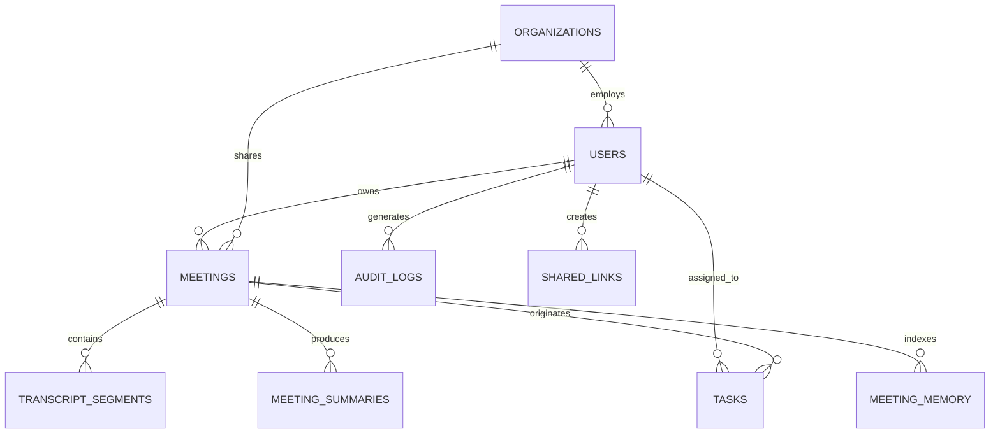

# MeetMind AI — Complete Database Schema & Data Models Specification
**Project:** MeetMind AI (Production ID: `meetmind-ai-74519`)  
**Architecture:** Hybrid Cloud Firestore (Frontend Real-Time & Mobile Web) + Relational SQLite/PostgreSQL (FastAPI Enterprise Engine)  
**Security Standard:** Strict User-Scoped Row-Level Security & Firestore Security Rules `rules_version = '2'`

---

## 1. Architectural Overview

MeetMind AI implements a resilient dual-layer data architecture:
1. **Client / Edge Tier (Firebase Cloud Firestore):** Real-time reactive updates, offline snapshot cache, zero-latency mobile sync, and user-isolated security rules.
2. **Backend / Enterprise Tier (FastAPI & SQLAlchemy ORM):** High-throughput analytical queries, bulk audit aggregation, automated background summarization jobs, and RAG vector citations.



---

## 2. Firebase Cloud Firestore Collections

### 2.1 Collection: `meetings`
Stores core meeting metadata, audio reference URLs, executive intelligence briefs, decisions, risks, sentiment scores, and diarized transcript turns.

| Field Name | Type | Required | Description |
| :--- | :--- | :--- | :--- |
| `id` | `String` (auto) | Yes | Unique Firestore Document ID |
| `userId` | `String` | Yes | Firebase Auth UID of the meeting owner |
| `orgId` | `String` | No | Optional Organization ID for enterprise workspace isolation |
| `title` | `String` | Yes | Meeting title or agenda heading |
| `duration` | `String` | Yes | Formatted meeting duration (e.g., `"28m 15s"`, `"01:14:20"`) |
| `durationSeconds`| `Number` | No | Exact duration in seconds for timeline computations |
| `time` | `String` | Yes | Human-readable timestamp (e.g., `"Today, 4:15 PM"`) |
| `category` | `String` | Yes | Categorization (`"Meetings"`, `"Permanent"`, `"Hot"`, `"General"`, `"Sprint"`) |
| `tint` | `String` | Yes | UI accent color token (`"lilac"`, `"peach"`, `"rose"`, `"mint"`, `"magenta"`, `"sky"`) |
| `audioUrl` | `String` | No | Secure Firebase Storage download URL for audio playback |
| `isBookmarked` | `Boolean` | No | Starred/Pinned flag for high-priority meetings |
| `executiveSummary` | `String` | Yes | AI-distilled comprehensive meeting synthesis |
| `keyPoints` | `Array<String>` | No | List of key bullet points extracted by AI |
| `decisions` | `Array<Object>` | No | `[{ id, text, timestamp, verified }]` |
| `actionItems` | `Array<Object>` | No | `[{ id, task, assignee, deadline, priority, status }]` |
| `risks` | `Array<Object>` | No | `[{ category: "budget"\|"deadline"\|"technical", severity: "high"\|"med"\|"low", description }]` |
| `sentiment` | `Object` | No | `{ score: Number (-1.0 to 1.0), label: "positive"\|"neutral"\|"critical", confidence: Number }` |
| `language` | `Object` | No | `{ detected: "en"\|"ur"\|"ur-roman"\|"mixed", primary: String, nastaliqAvailable: Boolean }` |
| `translations` | `Object` | No | `{ urduNastaliq: String, romanUrdu: String, english: String }` |
| `transcript` | `Array<Object>`| Yes | Diarized segments: `[{ speaker: "Speaker 1", time: "01:23", text: "..." }]` |
| `createdAt` | `Timestamp` | Yes | Server timestamp of creation |
| `updatedAt` | `Timestamp` | Yes | Server timestamp of last edit |

---

### 2.2 Collection: `tasks`
Stores actionable deliverables extracted automatically by AI or created manually by participants.

| Field Name | Type | Required | Description |
| :--- | :--- | :--- | :--- |
| `id` | `String` (auto) | Yes | Document ID |
| `userId` | `String` | Yes | Firebase Auth UID of owner |
| `meetingId` | `String` | No | Optional parent meeting reference |
| `title` | `String` | Yes | Action item description |
| `assignee` | `String` | Yes | Participant name or email |
| `deadline` | `String` | No | Human or ISO deadline date |
| `priority` | `String` | Yes | `"low"`, `"medium"`, `"high"`, `"urgent"` |
| `status` | `String` | Yes | `"pending"`, `"in_progress"`, `"completed"`, `"overdue"` |
| `createdAt` | `Timestamp` | Yes | Creation timestamp |

---

### 2.3 Collection: `users`
User profiles, subscription tiers, minutes quotas, and 2FA credentials.

| Field Name | Type | Required | Description |
| :--- | :--- | :--- | :--- |
| `uid` | `String` | Yes | Document ID matching Firebase Auth UID |
| `email` | `String` | Yes | User email address |
| `displayName` | `String` | Yes | Full name |
| `avatarUrl` | `String` | No | Profile photo path or avatar token |
| `plan` | `String` | Yes | `"Free"`, `"Pro"`, `"Business"`, `"Enterprise"` |
| `billingCycle` | `String` | Yes | `"monthly"` or `"annual"` |
| `paymentMethod` | `String` | No | `"JazzCash"`, `"Easypaisa"`, `"Raast"`, `"Card"`, `"None"` |
| `minutesUsed` | `Number` | Yes | Transcription/AI minutes consumed this billing period |
| `minutesLimit` | `Number` | Yes | Total quota allotted based on plan (e.g. 500 min for Pro) |
| `twoFactorEnabled` | `Boolean` | Yes | 2FA verification status |
| `orgId` | `String` | No | Affiliated Organization ID |
| `role` | `String` | Yes | `"owner"`, `"admin"`, `"manager"`, `"employee"`, `"viewer"` |
| `createdAt` | `Timestamp` | Yes | Account registration date |
| `lastLoginAt` | `Timestamp` | Yes | Most recent session start |

---

### 2.4 Collection: `sharedLinks`
Secure, unguessable public share tokens for Minutes of Meeting (MoM) distribution.

| Field Name | Type | Required | Description |
| :--- | :--- | :--- | :--- |
| `token` | `String` | Yes | Cryptographic unguessable share token |
| `meetingId` | `String` | Yes | Referenced meeting document ID |
| `userId` | `String` | Yes | Creator UID |
| `isPasswordProtected` | `Boolean` | Yes | Requires PIN/Password to view |
| `passwordHash` | `String` | No | Salted SHA-256 hash if protected |
| `viewOnly` | `Boolean` | Yes | Always true; prevents tampering |
| `expiresAt` | `Timestamp` | No | Optional expiry date |
| `accessCount` | `Number` | Yes | Counter of link views |
| `createdAt` | `Timestamp` | Yes | Creation time |

---

### 2.5 Collection: `meetingMemory`
Cross-meeting semantic index for RAG question answering.

| Field Name | Type | Required | Description |
| :--- | :--- | :--- | :--- |
| `id` | `String` (auto) | Yes | Memory fragment ID |
| `userId` | `String` | Yes | Scoped to user or organization |
| `meetingId` | `String` | Yes | Source meeting ID |
| `topic` | `String` | Yes | Extracted key subject (e.g. `"Payment Gateway"`) |
| `summarySnippet` | `String` | Yes | Concise fact or decision |
| `timestamp` | `String` | No | Meeting audio timestamp offset |
| `confidence` | `Number` | Yes | AI relevance score |

---

## 3. Relational Database Schema (SQLAlchemy & FastAPI)

### 3.1 DDL Schema
```sql
-- Users Table
CREATE TABLE users (
    id INTEGER PRIMARY KEY AUTOINCREMENT,
    email VARCHAR(255) UNIQUE NOT NULL,
    hashed_password VARCHAR(255) NOT NULL,
    full_name VARCHAR(255) DEFAULT 'Emily Watson',
    avatar_url VARCHAR(500) DEFAULT '/assets/emily.jpg',
    plan VARCHAR(50) DEFAULT 'Pro',
    minutes_used INTEGER DEFAULT 42,
    minutes_limit INTEGER DEFAULT 500,
    is_active BOOLEAN DEFAULT 1,
    created_at DATETIME DEFAULT CURRENT_TIMESTAMP
);

-- Meetings Table
CREATE TABLE meetings (
    id INTEGER PRIMARY KEY AUTOINCREMENT,
    user_id INTEGER NOT NULL REFERENCES users(id) ON DELETE CASCADE,
    title VARCHAR(255) NOT NULL,
    category VARCHAR(50) DEFAULT 'Meetings',
    tint VARCHAR(20) DEFAULT 'lilac',
    source_type VARCHAR(50) DEFAULT 'audio_recording',
    audio_file_path VARCHAR(500) NULL,
    duration_seconds INTEGER DEFAULT 0,
    created_at DATETIME DEFAULT CURRENT_TIMESTAMP
);

-- Transcript Segments
CREATE TABLE transcript_segments (
    id INTEGER PRIMARY KEY AUTOINCREMENT,
    meeting_id INTEGER NOT NULL REFERENCES meetings(id) ON DELETE CASCADE,
    speaker_label VARCHAR(100) DEFAULT 'Speaker 1',
    start_time VARCHAR(20) DEFAULT '00:00',
    end_time VARCHAR(20) DEFAULT '00:30',
    text TEXT NOT NULL
);

-- Meeting Summaries
CREATE TABLE meeting_summaries (
    id INTEGER PRIMARY KEY AUTOINCREMENT,
    meeting_id INTEGER NOT NULL UNIQUE REFERENCES meetings(id) ON DELETE CASCADE,
    executive_summary TEXT NOT NULL,
    key_points_json TEXT DEFAULT '[]',
    decisions_json TEXT DEFAULT '[]',
    action_items_json TEXT DEFAULT '[]',
    risks_json TEXT DEFAULT '[]',
    created_at DATETIME DEFAULT CURRENT_TIMESTAMP
);

-- Tasks & Action Items
CREATE TABLE tasks (
    id INTEGER PRIMARY KEY AUTOINCREMENT,
    user_id INTEGER NOT NULL REFERENCES users(id) ON DELETE CASCADE,
    meeting_id INTEGER REFERENCES meetings(id) ON DELETE SET NULL,
    title VARCHAR(255) NOT NULL,
    assignee VARCHAR(100) DEFAULT 'Unassigned',
    deadline VARCHAR(50) NULL,
    priority VARCHAR(20) DEFAULT 'medium',
    status VARCHAR(20) DEFAULT 'pending',
    created_at DATETIME DEFAULT CURRENT_TIMESTAMP
);

-- Chat Messages & RAG Queries
CREATE TABLE chat_messages (
    id INTEGER PRIMARY KEY AUTOINCREMENT,
    user_id INTEGER NOT NULL REFERENCES users(id) ON DELETE CASCADE,
    role VARCHAR(20) NOT NULL,
    content TEXT NOT NULL,
    citations_json TEXT DEFAULT '[]',
    created_at DATETIME DEFAULT CURRENT_TIMESTAMP
);

-- PHASE 4: Third-Party Integrations Ecosystem
CREATE TABLE integrations (
    id INTEGER PRIMARY KEY AUTOINCREMENT,
    user_id INTEGER NOT NULL REFERENCES users(id) ON DELETE CASCADE,
    provider VARCHAR(50) NOT NULL, -- google_calendar, gmail, google_drive, outlook, jira, trello, slack, notion, zapier, whatsapp
    connection_status VARCHAR(30) DEFAULT 'not_connected', -- not_connected, connecting, connected, expired, permission_required, error, disconnected
    account_email VARCHAR(255) DEFAULT '',
    account_name VARCHAR(255) DEFAULT '',
    external_account_id VARCHAR(255) DEFAULT '',
    authorized_scopes_json TEXT DEFAULT '[]',
    encrypted_access_token TEXT DEFAULT '',
    encrypted_refresh_token TEXT DEFAULT '',
    token_expiry DATETIME NULL,
    settings_json TEXT DEFAULT '{}',
    last_synced_at DATETIME NULL,
    error_message TEXT DEFAULT '',
    created_at DATETIME DEFAULT CURRENT_TIMESTAMP,
    updated_at DATETIME DEFAULT CURRENT_TIMESTAMP
);

CREATE TABLE external_entity_mappings (
    id INTEGER PRIMARY KEY AUTOINCREMENT,
    user_id INTEGER NOT NULL REFERENCES users(id) ON DELETE CASCADE,
    provider VARCHAR(50) NOT NULL,
    entity_type VARCHAR(50) NOT NULL, -- task_event, task_issue, task_card, meeting_page, drive_doc
    internal_id INTEGER NOT NULL,
    external_id VARCHAR(255) NOT NULL,
    external_url VARCHAR(500) DEFAULT '',
    sync_hash VARCHAR(64) DEFAULT '',
    last_synced_at DATETIME DEFAULT CURRENT_TIMESTAMP,
    created_at DATETIME DEFAULT CURRENT_TIMESTAMP
);

CREATE TABLE webhook_subscriptions (
    id INTEGER PRIMARY KEY AUTOINCREMENT,
    user_id INTEGER NOT NULL REFERENCES users(id) ON DELETE CASCADE,
    name VARCHAR(255) DEFAULT 'Custom Webhook',
    target_url VARCHAR(500) NOT NULL,
    secret_key VARCHAR(255) NOT NULL,
    events_json TEXT DEFAULT '[]',
    is_active BOOLEAN DEFAULT 1,
    created_at DATETIME DEFAULT CURRENT_TIMESTAMP,
    updated_at DATETIME DEFAULT CURRENT_TIMESTAMP
);

CREATE TABLE webhook_deliveries (
    id INTEGER PRIMARY KEY AUTOINCREMENT,
    subscription_id INTEGER NOT NULL REFERENCES webhook_subscriptions(id) ON DELETE CASCADE,
    user_id INTEGER NOT NULL REFERENCES users(id) ON DELETE CASCADE,
    event_type VARCHAR(100) NOT NULL,
    payload_json TEXT NOT NULL,
    status_code INTEGER DEFAULT 0,
    response_body TEXT DEFAULT '',
    success BOOLEAN DEFAULT 0,
    retry_count INTEGER DEFAULT 0,
    error_message TEXT DEFAULT '',
    delivered_at DATETIME DEFAULT CURRENT_TIMESTAMP
);

CREATE TABLE integration_jobs (
    id INTEGER PRIMARY KEY AUTOINCREMENT,
    user_id INTEGER NOT NULL REFERENCES users(id) ON DELETE CASCADE,
    provider VARCHAR(50) NOT NULL,
    job_type VARCHAR(50) NOT NULL,
    status VARCHAR(30) DEFAULT 'completed',
    details_json TEXT DEFAULT '{}',
    error_message TEXT DEFAULT '',
    created_at DATETIME DEFAULT CURRENT_TIMESTAMP,
    completed_at DATETIME DEFAULT CURRENT_TIMESTAMP
);

CREATE TABLE oauth_nonces (
    id INTEGER PRIMARY KEY AUTOINCREMENT,
    nonce VARCHAR(128) UNIQUE NOT NULL,
    user_id INTEGER NOT NULL REFERENCES users(id) ON DELETE CASCADE,
    provider VARCHAR(50) NOT NULL,
    code_verifier VARCHAR(255),
    consumed BOOLEAN DEFAULT 0 NOT NULL,
    consumed_at DATETIME,
    expires_at DATETIME NOT NULL,
    created_at DATETIME DEFAULT CURRENT_TIMESTAMP
);

CREATE TABLE processed_webhook_messages (
    id INTEGER PRIMARY KEY AUTOINCREMENT,
    provider VARCHAR(50) NOT NULL,
    message_id VARCHAR(255) UNIQUE NOT NULL,
    sender VARCHAR(255),
    processed_at DATETIME DEFAULT CURRENT_TIMESTAMP
);
```

---

## 4. Indexing & Query Optimization Strategy
1. **Firestore Compound Indexes:**
   - Collection `meetings`: `userId` ASC + `createdAt` DESC
   - Collection `tasks`: `userId` ASC + `status` ASC + `createdAt` DESC
   - Collection `meetingMemory`: `userId` ASC + `topic` ASC
2. **SQL Indexes:**
   - `users(email)`
   - `meetings(user_id, created_at)`
   - `tasks(user_id, status)`
   - `transcript_segments(meeting_id)`
   - `oauth_nonces(nonce, consumed, expires_at)`
   - `processed_webhook_messages(message_id, provider)`

