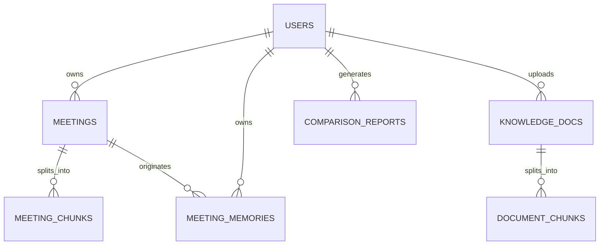
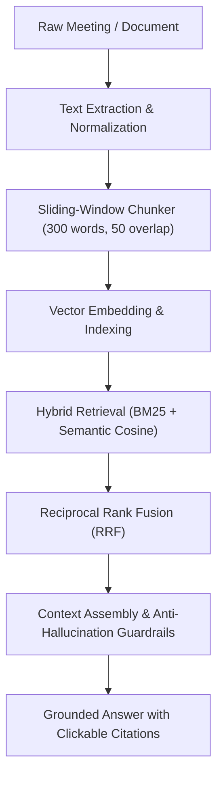

# MeetMind AI — Phase 2 Architecture & Implementation Plan
**Milestone:** Phase 2: AI Meeting Memory & Cross-Meeting Intelligence  
**Project:** MeetMind AI (`meetmind-ai-74519`)  
**Standard:** Enterprise Semantic RAG, Multi-Tenant Isolation, Free-Tier Cost Optimization  

---

## 1. Executive Summary & Goals

Phase 2 elevates MeetMind AI from a single-meeting summarizer into a centralized, persistent organizational intelligence platform. It introduces:
1. **Multi-Meeting Semantic Search:** Natural language search across all historical user meetings with keyword + semantic hybrid ranking.
2. **Meeting Comparison Matrix:** Automated delta analysis across any two meetings comparing objectives, decisions, budgets, tasks, deadlines, and risks.
3. **Company Knowledge Base (RAG):** Document processing (PDF, DOCX, TXT, CSV), sliding-window text chunking, and dual-scope question answering.
4. **Persistent Meeting Memory Engine:** Long-term memory structured across 10 organizational categories with revision preservation.
5. **Advanced Knowledge AI Chat:** Grounded multi-source assistant with clickable citations, strict anti-hallucination guardrails, and English/Urdu/Roman Urdu support.

---

## 2. Component Reuse & Technical Boundary

| Component | Status | Reuse Strategy |
| :--- | :--- | :--- |
| **Vanilla ES2026 Client** | Active | Preserve existing styling, zero build overhead, extend `app.html` and `app.js` |
| **Firebase Cloud Auth & Firestore** | Active | Retain user-scoped isolation rules; add collections for `meetingMemory`, `knowledgeDocuments`, `documentChunks` |
| **FastAPI Backend (`backend/`)** | Active | Extend SQLAlchemy models, add document parsers, search router, and comparison engine |
| **Gemini AI Cascade** | Active | Reuse `gemini-2.5-flash` / `gemini-1.5-flash` for synthesis, add `text-embedding-004` / Cosine similarity for vectors |
| **Audio-to-Transcript Player** | Active | Connect search results and chat citations directly to `seekToTranscriptTime` |

---

## 3. Data Architecture & New Schemas

### 3.1 New Database Entities
1. **`knowledge_documents` / Firestore `knowledgeDocuments`:**
   - `id`, `userId`, `orgId`, `filename`, `fileType` (`pdf`|`docx`|`txt`|`csv`), `fileSize`, `category`, `status` (`uploaded`|`processing`|`indexed`|`failed`), `chunkCount`, `createdAt`.
2. **`document_chunks` / Firestore `documentChunks`:**
   - `id`, `documentId`, `chunkIndex`, `text`, `pageNumber`, `embedding_json`, `tokenCount`.
3. **`meeting_chunks` / Firestore `meetingChunks`:**
   - `id`, `meetingId`, `speakerLabel`, `startTime`, `endTime`, `text`, `embedding_json`.
4. **`meeting_memories` / Firestore `meetingMemories`:**
   - `id`, `userId`, `category` (1-10), `factStatement`, `meetingId`, `meetingTitle`, `timestamp`, `revisionsJson`, `createdAt`, `updatedAt`.

---

## 4. Semantic Search & RAG Processing Pipeline

---

## 5. Free-Tier Cost Optimization & Guardrails
- **Generate Embeddings Once:** Chunks are embedded on ingestion and cached in SQLite/IndexedDB to prevent duplicate API hits.
- **Token Budgeting:** Search queries and prompt contexts are capped at 2,000 tokens to remain well within free-tier limits.
- **Offline / Local Fallback:** When offline or when Gemini quota is exhausted, the system transitions gracefully to local token-frequency BM25 and synonym-expansion ranking.

---

## 6. Implementation Milestones
- **Module 1:** Multi-Meeting Semantic Search (`#page-search`)
- **Module 2:** Meeting Comparison Matrix (`#page-compare`)
- **Module 3:** Company Knowledge Base (`#page-knowledge-base`)
- **Module 4:** Meeting Memory Engine (`#page-memory`)
- **Module 5:** Advanced AI Knowledge Chat (`#page-chat`)
- **Verification:** 10 Real Scenarios Tested in Headless Chrome & Backend Pytest

