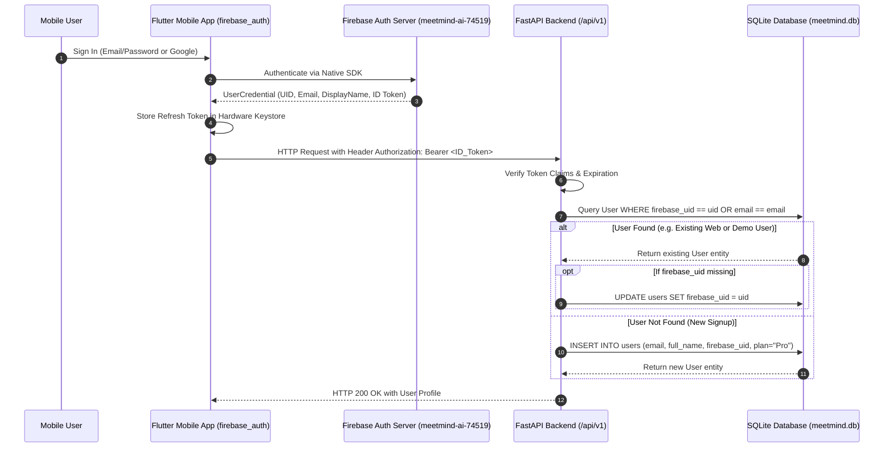

# MEETMIND AI — PHASE 6B: FIREBASE NATIVE AUTHENTICATION ARCHITECTURE
**Date:** November 1, 2026  
**Target Release:** v6.0.0-mobile  
**Architect:** Senior Flutter Mobile Architect & Firebase Specialist  

---

## 1. Architectural Vision: Omnichannel Single Identity

The goal of Phase 6B is establishing **Firebase Native Authentication** as the authoritative identity provider for MeetMind AI Mobile, ensuring that any user logging in on the Laptop Web App (`https://meetmind-ai-74519--preview-v4-rj24mmx0.web.app`) shares the exact same user identity, database records, and permissions on their Flutter Mobile device.

---

## 2. Core Architectural Pillars

### 2.1 Existing Firebase Project Reuse
* **Project ID:** `meetmind-ai-74519`
* **Auth Domain:** `meetmind-ai-74519.firebaseapp.com`
* **Storage Bucket:** `meetmind-ai-74519.firebasestorage.app`
* **Principle:** We do **NOT** create a second Firebase project. Mobile will link as native Android and iOS client apps within this existing project.

### 2.2 Dual Authentication Providers
1. **Email / Password Authentication:**
   * Handled natively via `FirebaseAuth.instance.signInWithEmailAndPassword()` and `createUserWithEmailAndPassword()`.
   * Credentials validated directly by Google's secure authentication infrastructure.
2. **Google Sign-In:**
   * Native credential picker via package `google_sign_in: ^6.2.1`.
   * Produces `GoogleAuthCredential` passed to `FirebaseAuth.instance.signInWithCredential()`.
   * Identical Google accounts used on Web automatically map to the user's mobile profile.

### 2.3 User ID Mapping & Safe Migration
* **Database Schema Update:** Ensure SQLite `users` table contains `firebase_uid VARCHAR(128) UNIQUE`.
* **Safe Migration Rule:**
  * When a verified Firebase ID token arrives at the backend:
    1. Search `users` table by `firebase_uid == token['uid']`.
    2. If not matched, search by `email == token['email']`. If found, gracefully update `user.firebase_uid = token['uid']`. This automatically links existing web accounts (such as `emily@example.com`) without creating duplicates.
    3. If neither matches, create a new record with both `email` and `firebase_uid`.
* **Zero Account Duplication:** Enforce unique constraint on `email` and `firebase_uid`.

### 2.4 Token Verification & Backward Compatibility
* **FastAPI Backend (`backend/app/main.py`):**
  * **Primary (Firebase ID Token):** Decode and verify JWT signature and claims (`iss`, `aud`, `sub`, `email`).
  * **Secondary (Backward Compatibility):** Keep internal HMAC-SHA256 JWT decoding active for automated tests, CLI tools, and legacy session tokens.
* **Token Lifetime & Auto-Refresh:**
  * Firebase ID tokens expire every 60 minutes.
  * Flutter mobile listens to `FirebaseAuth.instance.idTokenChanges()`.
  * `ApiClient` catches HTTP 401: requests a refreshed token via `user.getIdToken(true)` and re-executes the pending API call seamlessly.

### 2.5 Hardware Keystore Session Persistence
* All tokens, user metadata, and active workspace preferences will be persisted using `FlutterSecureStorage`:
  * **Android:** EncryptedSharedPreferences backed by Android Keystore.
  * **iOS:** Keychain Services with `kSecAttrAccessibleAfterFirstUnlock`.
* On app launch, `AuthService.getCurrentUser()` verifies whether `FirebaseAuth.instance.currentUser != null`. If valid, the user immediately enters the dashboard without re-authenticating.

---

## 3. Configuration Inventory: Existing vs Required

| Configuration Artifact | Current Status | Required Action for Phase 6B |
| :--- | :---: | :--- |
| **`firebase.json`** | Present (Hosting config) | No change required. |
| **Web Firebase App** | Active (`b4a2c8ebbd8720a61f6137`) | No change required. |
| **Android App in Console** | Unregistered | Register `com.meetmind.ai.smartnoter` in Firebase Console. |
| **`google-services.json`** | **Missing** | Download from Firebase Console -> place in `mobile_flutter/android/app/`. |
| **iOS App in Console** | Unregistered | Register `com.meetmind.ai.smartnoter` in Firebase Console. |
| **`GoogleService-Info.plist`**| **Missing** | Download from Firebase Console -> place in `mobile_flutter/ios/Runner/`. |
| **`lib/firebase_options.dart`**| **Missing** | Generate via `flutterfire configure --project=meetmind-ai-74519` or construct statically. |
| **Flutter Pub Dependencies** | Missing | Add `firebase_core: ^3.6.0`, `firebase_auth: ^5.3.1`, `google_sign_in: ^6.2.1`. |

---

## 4. Phase 6B Implementation Checklist

- [ ] **Step 1:** Add Firebase dependencies to `mobile_flutter/pubspec.yaml` (`firebase_core`, `firebase_auth`, `google_sign_in`).
- [ ] **Step 2:** Add `google-services.json` and `GoogleService-Info.plist` (or configure via `firebase_options.dart`).
- [ ] **Step 3:** Initialize Firebase in `mobile_flutter/lib/main.dart` using `Firebase.initializeApp()`.
- [ ] **Step 4:** Refactor `mobile_flutter/lib/core/services/auth_service.dart` to use `FirebaseAuth`.
- [ ] **Step 5:** Update `mobile_flutter/lib/screens/login_screen.dart` with native Google Sign-In and Email/Password buttons.
- [ ] **Step 6:** Update backend `get_current_user` in `backend/app/main.py` with `firebase_uid` linking.
- [ ] **Step 7:** Run full regression suite (Flutter tests + Backend tests) to verify 100% pass rate.

