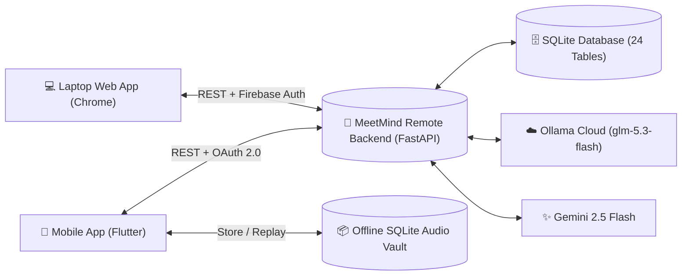
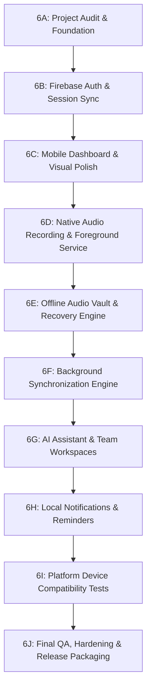

# MEETMIND AI — PHASE 6: MASTER DEVELOPMENT ROADMAP
**Version:** 6.0.0-mobile  
**Architecture:** Cross-Platform Flutter + FastAPI + Firebase + SQLite Offline Vault  
**Design Reference:** Dribbble AI Meet Note Tracker & Dark Cosmic Glassmorphism  
**Target Ingress:** Dynamic Gateway (Localhost / Persistent Tunnel / Cloud Run)  

---

## Executive Vision: Single Account, Omnichannel Intelligence

The user operates a unified workflow:
1. **Laptop:** Schedule meetings, review multi-speaker transcripts, compare meeting versions, and export formatted MoM PDFs.
2. **Mobile:** Record audio natively on-the-go with real-time waveform visualization, even in airplane mode.
3. **Offline Audio Vault:** Encrypted local SQLite storage preserves raw recordings with SHA-256 pre-upload checksums.
4. **Auto Cloud Sync:** Background engine detects network reconnection and auto-resumes multipart uploads with idempotency keys.
5. **Shared Intelligence:** Tasks, AI chat memory, collaborative notes, and workspaces stay in real-time sync across both devices.

---

## Sequential Implementation Roadmap: Phase 6A through 6J

---

### Phase 6A — Project Audit & Development Foundation (COMPLETED ✅)
* **Goal:** Verify Flutter environment, dependencies, toolchains, remote backend connectivity, and local database backup.
* **Deliverables:**
  * `PHASE_6_PROJECT_AUDIT.md`
  * `PHASE_6_MASTER_ROADMAP.md`
  * `PHASE_6_FEATURE_STATUS.md`
* **Test Verification:**
  * `flutter doctor -v`: Flutter 3.47.8 / Dart 3.13.7.
  * `flutter pub get`: Clean resolution, 0 dependency conflicts.
  * `flutter analyze`: **0 issues found** (clean code).
  * `flutter test`: 7/7 unit and widget tests passing.
  * Backend endpoints `/health`, `/ready`, `/auth/login`, and `/users/me`: 200 OK.
  * Database verified: Pre-migration backup stored at `backups/meetmind_phase6_pre_migration_backup.db`.
* **Blockers Identified:** Local Windows machine requires OpenJDK 17 and Android SDK Command-line Tools for direct local APK building. Flutter Web, Desktop, and CI/CD targets are unblocked.

---

### Phase 6B — Firebase Authentication & Backend Connectivity
* **Goal:** Connect Web and Mobile to the identical user account via Firebase Authentication and JWT token persistence.
* **Features:**
  * Email and password sign-in and sign-up.
  * Google Sign-In with native credential picker.
  * Demo 1-Click Guest access (`emily@example.com`).
  * Hardware-backed token storage via `FlutterSecureStorage` (Android Keystore / iOS Keychain).
  * Auto-refresh of expired tokens and unified user session state.
* **Files to Modify:**
  * `mobile_flutter/lib/core/services/auth_service.dart`
  * `mobile_flutter/lib/providers/auth_provider.dart`
  * `mobile_flutter/lib/screens/login_screen.dart`
* **Security & Quality:**
  * Zero secret leakage in client code.
  * Dynamic API gateway configuration in Settings screen.
* **Tests:** Mocked auth provider tests, invalid token rejection test, session restoration widget test.

---

### Phase 6C — Mobile Dashboard & Meeting Management (Visual Polish)
* **Goal:** Implement the visual aesthetic inspired by Dribbble designs (Dark Cosmic theme, Glassmorphic navigation, and 3D avatars).
* **Features:**
  * **Hero "Next Meeting" Card:** Upcoming meeting with participant avatars and "Join Meeting" quick button.
  * **Interactive Calendar Day Strip:** Horizontal date picker (Mon–Sun) showing scheduled meetings.
  * **Today's Overview KPI Grid:** Meetings Today, AI Recaps count, and minutes used meter.
  * **Multi-Tab Meeting Details:**
    * Tab 1: Executive Summary (Bilingual: English, Urdu Nastaliq RTL, Roman Urdu).
    * Tab 2: Multi-Speaker Transcript with speaker avatar bubbles and timestamp tags.
    * Tab 3: Key Decisions & Action Items with toggleable completion checkboxes.
    * Tab 4: Minutes of Meeting (MoM) PDF viewer and native OS share dialog.
* **Files to Modify:**
  * `mobile_flutter/lib/screens/dashboard_screen.dart`
  * `mobile_flutter/lib/screens/meetings_screen.dart`
  * `mobile_flutter/lib/screens/meeting_detail_screen.dart`
* **Tests:** Meeting card rendering test, RTL Urdu layout test, transcript timestamp tap jump test.

---

### Phase 6D — Native Audio Recording & Studio
* **Goal:** High-fidelity, reliable mobile recording studio with visual amplitude feedback.
* **Features:**
  * High-quality AAC-LC recording (128 kbps, 44.1 kHz).
  * 24-bar animated real-time audio waveform visualizer.
  * Start, Pause, Resume, and Stop controls with digital timecode counter.
  * Bookmark important meeting moments with timestamped markers.
  * Participant recording consent confirmation prompt.
  * Android Foreground Service Notification with Pause/Stop action buttons.
  * iOS Audio Session interruption handler (`AVAudioSessionInterruptionNotification`).
* **Files to Modify:**
  * `mobile_flutter/lib/core/services/audio_recording_service.dart`
  * `mobile_flutter/lib/screens/recording_studio_screen.dart`
  * `mobile_flutter/android/app/src/main/AndroidManifest.xml`
  * `mobile_flutter/ios/Runner/Info.plist`
* **Tests:** Recording state transition test, amplitude stream listener test, duration formatting test.

---

### Phase 6E — Offline Audio Vault & Recovery Engine
* **Goal:** Guarantee that users can record meetings without any internet access and never lose recorded audio.
* **Features:**
  * Persistent local SQLite storage in `meetmind_offline_vault.db`.
  * Unique RFC 4122 UUID v4 assigned to each recording immediately.
  * Pre-upload SHA-256 cryptographic checksum calculation.
  * 6 Lifecycle Sync States:
    1. `Local Only`
    2. `Waiting for Connection`
    3. `Uploading`
    4. `Synced`
    5. `Failed`
    6. `Retry Required`
  * Zero-Loss Safety Rule: Local audio files are **never deleted automatically**, even after successful cloud synchronization.
  * Orphaned File Recovery: Crash recovery scanner on app startup detects incomplete recordings and packages them into the vault.
* **Files to Modify:**
  * `mobile_flutter/lib/core/services/vault_database.dart`
  * `mobile_flutter/lib/models/vault_recording_model.dart`
  * `mobile_flutter/lib/providers/vault_provider.dart`
  * `mobile_flutter/lib/screens/vault_screen.dart`
* **Tests:** SQLite vault CRUD test, SHA-256 checksum consistency test, corrupted file recovery test.

---

### Phase 6F — Background Synchronization Engine
* **Goal:** Automatically detect network restoration and dispatch pending audio uploads without user intervention.
* **Features:**
  * `connectivity_plus` network state listener.
  * Auto-trigger upload queue upon Wi-Fi or Cellular reconnection.
  * Exponential backoff retry algorithm:
    $$\text{Retry Delay} = \min(2^{\text{retryCount}} \times 2,\, 60)\text{ seconds}$$
  * Server-side idempotency verification via `X-Idempotency-Key` header.
  * Server response SHA-256 verification before transitioning state to `Synced`.
* **Files to Modify:**
  * `mobile_flutter/lib/core/services/background_sync_engine.dart`
  * `mobile_flutter/lib/core/services/api_client.dart`
* **Tests:** Network disconnect/reconnect simulation test, idempotency header verification test, retry delay calculation test.

---

### Phase 6G — AI Intelligence & Team Workspaces
* **Goal:** Conversational meeting memory and cross-platform team collaboration.
* **Features:**
  * Conversational RAG Meeting Chat with model selector:
    * Google Gemini 2.5 Flash
    * Ollama Cloud `glm-5.3-flash` (via server-side proxy)
  * Graceful HTTP 402 guardrail display with billing navigation link.
  * Persistent Organizational Memory categorized by business department.
  * Team Workspaces (Cowlar Engineering) with Role-Based Access Control (Admin, Editor, Viewer).
  * Real-time collaborative note editor synchronized with Web dashboard.
* **Files to Modify:**
  * `mobile_flutter/lib/screens/chat_screen.dart`
  * `mobile_flutter/lib/screens/workspace_screen.dart`
  * `mobile_flutter/lib/screens/memory_screen.dart`
* **Tests:** AI chat message append test, Ollama 402 error handler test, collaborative note version conflict test.

---

### Phase 6H — Local Notifications & Reminders
* **Goal:** Alert users of critical events and background recording status.
* **Features:**
  * `flutter_local_notifications` initialization for Android and iOS.
  * Persistent foreground notification during live recording.
  * Background upload completion alert (e.g. *"Meeting 'Product Strategy' uploaded & AI Summary ready"*).
  * Action item task deadline reminders.
* **Files to Modify:**
  * `mobile_flutter/lib/core/services/notification_service.dart`
  * `mobile_flutter/lib/main.dart`
* **Tests:** Notification channel setup test, payload handler test.

---

### Phase 6I — Platform Compatibility & Testing
* **Goal:** Multi-viewport regression testing across mobile, web, and desktop.
* **Execution:**
  * Test Material 3 Dark & Light theme rendering across high-density mobile screens.
  * Test RTL layout inversion for Urdu Nastaliq strings.
  * Document physical device testing procedures (Android APK sideload and TestFlight instructions).
* **Deliverables:**
  * `PHASE_6_TEST_REPORT.md` updated with full matrix.

---

### Phase 6J — Final QA, Build & Release Readiness
* **Goal:** Final release sign-off, security verification, and distribution artifacts.
* **Execution:**
  * Run full regression suite: Backend (57), Staging (36), Flutter (15+), Browser (103).
  * Android Release Keystore documentation and `key.properties` configuration template.
  * Deploy final preview channel: `https://meetmind-ai-74519--preview-v4-rj24mmx0.web.app`.
  * Git tagging: `v6.0.0-final`.

