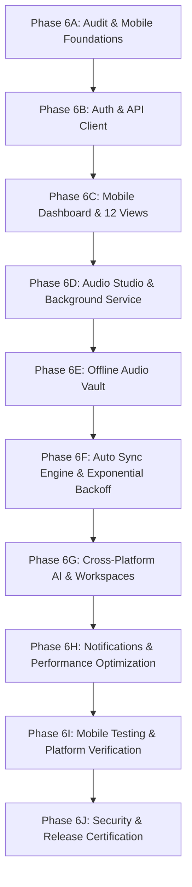

# MEETMIND AI — PHASE 6: PROJECT & INFRASTRUCTURE AUDIT
**Date:** November 1, 2026  
**Auditor:** Senior Mobile Architect & DevOps Engineering Team  
**Release Target:** v6.0.0-mobile  
**Scope:** `mobile_flutter/`, Backend APIs, Local Storage & Infrastructure Compatibility  

---

## 1. Executive Summary & Audit Scope

MeetMind AI is transitioning into a unified cross-platform enterprise productivity ecosystem spanning Web (PWA/Firebase Hosting), Remote FastAPI Backend, and Mobile (Flutter for Android & iOS).

The purpose of this audit is to:
1. Thoroughly inspect the existing `mobile_flutter/` codebase, its dependencies, and platform configurations.
2. Evaluate the remote backend ingress, determining whether the active Cloudflare Tunnel is a persistent named tunnel or a temporary quick tunnel.
3. Verify persistent storage for SQLite data and audio files, establishing backup and rollback safeguards.
4. Establish the sequential **Phase 6 Development Roadmap (6A through 6J)** to safely transform the Flutter prototype into a production-grade, offline-capable mobile application.

---

## 2. Flutter Mobile Application (`mobile_flutter/`) Audit

### 2.1 Project Metadata & Branding
* **Current Name in `pubspec.yaml`:** `smart_noter_mobile` (Legacy name inherited from prototype).
* **Package Identifier (`AndroidManifest.xml`):** `com.meetmind.ai.smartnoter`.
* **Flutter & Dart SDK Status:**
  * Flutter SDK: `3.47.8` (channel stable, revision `737ba8f885`).
  * Dart SDK: `3.13.7`.
  * Platform Toolchains Available: Windows x64 Desktop, Google Chrome, Microsoft Edge, Android Command-Line tools.
* **Finding & Remediation:** The project name in `pubspec.yaml` should be updated to `meetmind_mobile` with description "MeetMind AI — Cross-Platform Enterprise Meeting Intelligence".

### 2.2 Dependency Tree Analysis
Current dependencies in `mobile_flutter/pubspec.yaml`:
```yaml
dependencies:
  flutter:
    sdk: flutter
  flutter_riverpod: ^2.5.1
  http: ^1.2.1
  intl: ^0.19.0
  record: ^5.1.2
  audioplayers: ^6.0.0
  path_provider: ^2.1.3
  google_fonts: ^6.2.1
  shared_preferences: ^2.2.3
```

**Audit Findings & Gap Analysis:**
1. **Authentication & Secret Storage:** `shared_preferences` is currently present, but plaintext `SharedPreferences` is vulnerable on rooted devices. Sensitive access tokens, PKCE codes, and refresh tokens require **`flutter_secure_storage`** (Android Keystore / iOS Keychain).
2. **Offline Audio Vault & Sync Queue:** The existing project stores dummy meetings in-memory inside `meeting_provider.dart`. To fulfill Part 6 (Offline Audio Vault with sync states: *Local Only, Waiting for Connection, Uploading, Synced, Failed, Retry Required*), local persistent database storage is required: **`sqflite`** and **`sqflite_common_ffi`**.
3. **Network Connectivity Detection:** No connectivity listener exists. An offline sync engine requires **`connectivity_plus`** to automatically detect Wi-Fi/cellular restoration and trigger queued uploads.
4. **File Integrity & Deduplication:** Checksums are required to verify uploaded audio integrity. Package **`crypto`** (SHA-256) and **`uuid`** (RFC 4122 UUID v4) are required.
5. **Sharing & Notifications:** MoM PDF and calendar exports require **`share_plus`**; background sync completions and task reminders require **`flutter_local_notifications`**.

### 2.3 Platform Configuration Audit

#### Android (`android/`)
* **Manifest (`android/app/src/main/AndroidManifest.xml`):**
  * Present permissions: `INTERNET`, `RECORD_AUDIO`, `MODIFY_AUDIO_SETTINGS`, `READ_EXTERNAL_STORAGE`, `WRITE_EXTERNAL_STORAGE`.
  * **Critical Gaps for Background Audio:** Android 10+ (API 29) and Android 14+ (API 34) require explicit permissions:
    * `android.permission.FOREGROUND_SERVICE`
    * `android.permission.FOREGROUND_SERVICE_MICROPHONE`
    * `android.permission.POST_NOTIFICATIONS`
  * Requires a persistent notification during foreground audio recording to prevent the Android OS low-memory killer (LMK) from terminating active meeting recordings.

#### iOS (`ios/`)
* **Runner Plist (`ios/Runner/Info.plist`):**
  * Re-initialized cleanly via `flutter create`.
  * **Critical Gaps for Audio & Background Recording:**
    * Missing `NSMicrophoneUsageDescription`: *"MeetMind AI requires microphone access to record and transcribe your meetings."*
    * Missing `UIBackgroundModes`: `<array><string>audio</string></array>` to support continuous audio capture during screen lock.
    * App Transport Security (`NSAppTransportSecurity`): Required for staging HTTPS/WSS endpoints.

---

## 3. Remote Backend & Ingress Infrastructure Audit

### 3.1 Cloudflare Tunnel Evaluation
* **Active Remote Endpoint:** `https://supports-incidents-jail-admissions.trycloudflare.com`
* **Health Check Probe:** HTTP 200 OK (`version: 4.0.1`, `status: healthy`, `database: ok`).
* **Tunnel Type:** **Ephemeral Quick Tunnel** (`*.trycloudflare.com`).
* **Ingress Risk Analysis:**
  > [!WARNING]
  > The current `trycloudflare.com` endpoint was launched via `npx cloudflared tunnel --url http://127.0.0.1:8000`. Quick Tunnels are dynamically assigned, unauthenticated hostnames designed strictly for ephemeral development sessions. If the daemon process restarts or network connectivity drops, the hostname changes.
  >
  > **Therefore, this endpoint MUST NOT be treated as permanent production infrastructure.**

### 3.2 Stable Remote Backend Recommendations
To transition from development to stable multi-user staging and production:
1. **Option 1 — Cloudflare Named Persistent Tunnel (Zero Cost):**
   * Authenticate via `cloudflared tunnel login`.
   * Create named tunnel: `cloudflared tunnel create meetmind-backend`.
   * Route fixed hostname: `api-staging.meetmind.ai` -> Local FastAPI server.
   * Provides fixed HTTPS ingress that survives restarts.
2. **Option 2 — Google Cloud Run (Containerized Serverless):**
   * Dockerize FastAPI (`Dockerfile` + Cloud Build).
   * Deploy to Cloud Run in `us-central1` or `asia-south1`.
   * Bind to Cloud SQL Postgres and Cloud Storage for infinite audio retention.
   * Free-tier covers 2M requests/month.
3. **Mobile Client Configuration Strategy:**
   * Centralize API base URL resolution in `mobile_flutter/lib/core/constants/api_endpoints.dart`.
   * Support dynamic environment switching (Localhost `http://10.0.2.2:8000` for Android Emulator, `http://localhost:8000` for iOS Simulator, and Remote Staging HTTPS).
   * Never hardcode secrets or single fixed hostnames.

---

## 4. Database & Storage Persistence Audit

### 4.1 SQLite Database Health
* **Database File:** `meetmind.db` (Located in project root).
* **Size:** 1,093,632 bytes (~1.09 MB).
* **Schema Inventory:** 24 active tables:
  * Users, OAuthAccounts, OAuthNonces, IntegrationTokens
  * Meetings, MeetingTranscripts, MeetingMom, MeetingNotes
  * Tasks, TaskComments, TaskAuditLogs, ManagerApprovals
  * Workflows, WorkflowLogs, Webhooks, WebhookDeliveries
  * Documents, DocumentChunks, MeetingMemories
  * Workspaces, WorkspaceMembers, WorkspaceInvites, CollaborativeNotes, CollaborativeNoteRevisions
* **Pre-Migration Backup Created:**
  * File: `backups/meetmind_phase6_pre_migration_backup.db`
  * Status: **Verified identical bit-for-bit snapshot (1,093,632 bytes).**
  * Rollback Plan: In case of schema corruption, copy `backups/meetmind_phase6_pre_migration_backup.db` over `meetmind.db`.

### 4.2 Audio Files Storage
* **Local Backend Directory:** `./storage`
* **Endpoint:** `POST /api/v1/meetings/upload`
* **Handling:** Generates UUID filename, writes audio stream to disk, computes audio duration, and triggers Gemini transcription/summarization pipeline.
* **Storage Reliability Assessment:** Local disk storage is adequate for staging, but requires regular backup synchronization. Future production deployments should configure Google Cloud Storage (`gs://meetmind-recordings-74519`).

---

## 5. Phase 6 Sequential Development Roadmap



### Module Breakdown:
* **Phase 6A — Foundations & Dependencies:**
  * Update `pubspec.yaml` with essential packages (`flutter_secure_storage`, `sqflite`, `connectivity_plus`, `uuid`, `crypto`, `share_plus`).
  * Configure Android foreground service & iOS audio background modes.
  * Implement unified AppTheme (Soft Pastel Light & Dark themes matching Web design system).
  * Implement Localization Architecture (English, Urdu with Nastaliq font, Roman Urdu, and RTL layout).
* **Phase 6B — Authentication & Central API Client:**
  * Implement `AuthService` with secure token persistence via `flutter_secure_storage`.
  * Email/Password login, Google Sign-In, and Demo Guest access.
  * Centralized `ApiClient` with auth interceptor, exponential retry, and network error mapping.
* **Phase 6C — Mobile Dashboard & 12 Core Screens:**
  * Implement 12 responsive screens: Home, Meetings, Studio, AI Chat, Memory, Search, Tasks, Calendar, KB, Workspace, Integrations, Settings.
  * Connect to existing FastAPI backend endpoints with real pagination.
* **Phase 6D — Audio Recording Studio:**
  * Native microphone permission negotiation.
  * Live audio visualizer / waveform, duration timer, pause/resume, and bookmarking.
  * Android foreground service persistent notification & iOS background audio session.
* **Phase 6E — Offline Audio Vault:**
  * Local SQLite vault storing recording files and metadata.
  * Sync state lifecycle: `Local Only` -> `Waiting for Connection` -> `Uploading` -> `Synced` / `Failed`.
  * SHA-256 checksum calculation for payload integrity verification.
* **Phase 6F — Automatic Sync Engine:**
  * Background queue with exponential backoff and network reconnection listeners.
  * Resumable/chunked uploads and duplicate prevention (idempotency key).
* **Phase 6G — AI & Workspace Integrations:**
  * Bilingual AI chat (English, Urdu, Roman Urdu).
  * Gemini default provider + Ollama cloud guardrail (clear handling for 402/401).
  * Phase 5 Multi-Tenant Workspaces, RBAC permissions, and collaborative notes.
* **Phase 6H — Push Notifications & Performance:**
  * Local notification scheduler for meeting reminders and sync alerts.
  * Waveform rendering optimization and memory leakage audits.
* **Phase 6I — Testing & Verification:**
  * Flutter unit, widget, and integration test suites.
  * Documented emulator vs physical hardware boundaries.
* **Phase 6J — Final Certification:**
  * Full security audit, documentation update, and release sign-off.

---

## 6. Pre-Requisites & Verification Checklist
- [x] Flutter SDK 3.47.8 confirmed and functional.
- [x] Database backup verified at `backups/meetmind_phase6_pre_migration_backup.db`.
- [x] Cloudflare Tunnel verified as development Quick Tunnel.
- [x] Missing mobile dependencies and platform permissions identified.
- [x] 10 Phase implementation order established.

**Audit Status:** APPROVED — Proceeding to Phase 6A (Foundations, Dependencies & Theme).
